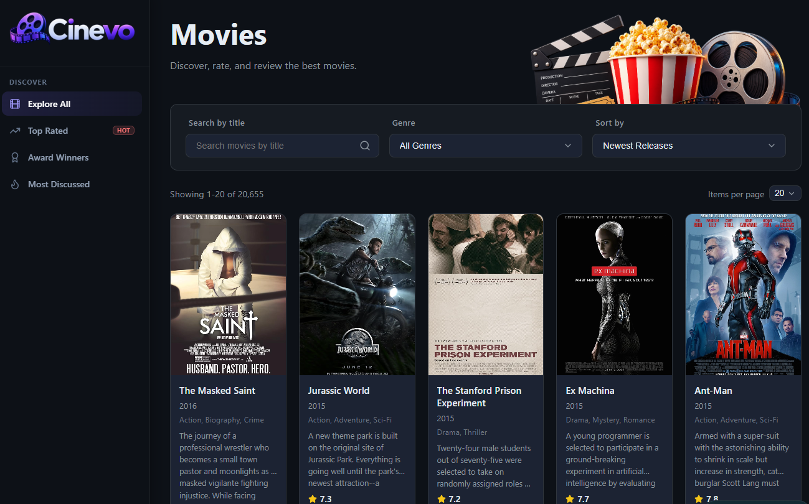
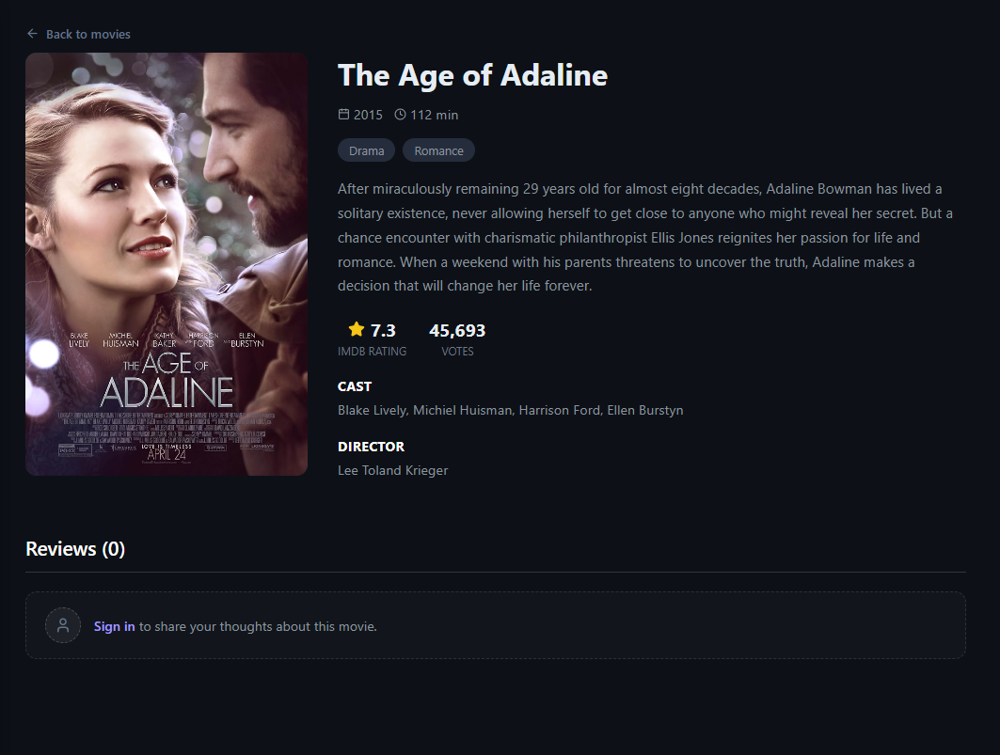

# Cinevo

Cinevo is a movie discovery and review experience for anyone deciding what to watch next. Explore films, compare IMDb ratings, learn more about a story and its cast, and read what other viewers think before making your pick.

Whether you have a title in mind or want to browse for something unexpected, Cinevo gives you a few simple ways to start.

## Discover something worth watching

Movie cards bring together posters, release years, genres, short plot summaries, and IMDb ratings where available. Choose 10, 15, or 20 movies per page and browse at your own pace.

## Get to know a film before you choose

Open a movie to explore its story, runtime, release year, genres, cast, and directors. IMDb ratings and vote counts add another perspective, while viewer reviews give you individual takes on the film.

Expand longer plot summaries when you want more detail, then return to your browsing results to keep exploring. Movie information appears when it is available in the catalog.

## Add your voice

Browse movies and read reviews without an account. When you want to join the conversation, create an account or sign in to write a review directly on a movie's page.

## License

This project is licensed under the [MIT](LICENSE) License.
